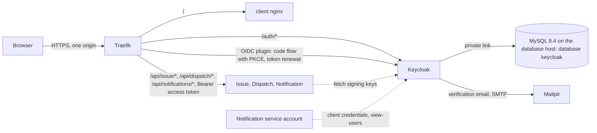

# Keycloak setup guide (design level)

**Status:** implemented for the local stack in EN-02-04 (2026-11-24): Keycloak 26.8.2 with the realm `bmc`, the traefik-oidc-auth plugin v0.24.0 and synthetic accounts run from `compose.yaml` and `compose.local.yaml`, and sign-in is checked end to end by `scripts/e2e-signin.sh`. [Section 12](#12-as-implemented-in-en-02-04) lists what was built and which "to confirm" items below are now settled; where a section and section 12 differ, section 12 is what runs. Not yet run on the dev host. Sections 1–11 are the design of EN-01-01 (2026-10-27; revised 2026-11-01 after the PR #45 reviews, and again the same day: the traefik-oidc-auth plugin replaces oauth2-proxy)

**Audience:** the team members who will set up identity in the spike (Ricardo, Afonso, Martim for infrastructure). Decision and reasons: [ADR-005](../adr/ADR-005-authentication-authorisation.md). Evidence IDs (E27, E88 …) refer to the [evidence register](../adr/README.md#evidence-register-en-01-01). Anything marked **to confirm in the spike** is not in the register and must be checked against the Keycloak, traefik-oidc-auth or Traefik documentation before use. Placeholders such as `<KEYCLOAK_ADMIN_PASSWORD>` stand for values that come from the environment; no real secret, hostname or password belongs in this file or in Git.

## 1. Purpose and scope

The guide describes what to configure so that spike items 1 (Keycloak 26.8 on MySQL 8.4 with realm import) and 3 (Traefik's OIDC plugin returns `401` to API calls without a session and forwards the access token) can be run. It does not cover production hardening, token lifetimes or rotation of the plugin's `Secret` (EN01-U6, EN-01-04), and it does not describe how the services validate tokens beyond the points that affect Keycloak. Keycloak stays the identity provider; a managed identity provider was considered and not adopted for the MVP ([ADR-005](../adr/ADR-005-authentication-authorisation.md)). Social login could be added later with Keycloak's identity brokering; it is not in the MVP.

## 2. Components and how they connect

- Only Traefik is exposed. The browser sees one origin; `/auth/*` is Keycloak; the plugin's callback, login and logout paths are answered by Traefik's OIDC middleware itself (section 9). There is no oauth2-proxy.
- On `/api/*` Traefik's OIDC middleware, the community plugin traefik-oidc-auth (E88), checks the session cookie. With a valid session it adds `Authorization: Bearer <access token>` and Traefik forwards the request to the service; without one it answers `401` (section 9).
- The services are resource servers: they fetch Keycloak's signing keys and validate issuer, audience and expiry themselves (E16). Traefik Proxy cannot validate JWTs (E35).
- The Notification service logs in to Keycloak as a service account to look up email addresses by `sub`.

## 3. MySQL 8.4 prerequisites

Keycloak is supported on MySQL 8.4 and 8.0 only; 8.0 is end of life (2026-04-30) and 9.x is unsupported (E27, E44). The platform runs `mysql:8.4`.

| Item | Setting | Evidence |
|---|---|---|
| Database | A dedicated database named `keycloak` | Brief; one database per service ([ADR-001](../adr/ADR-001-backend-boundaries.md)) |
| User | A dedicated user (`keycloak`) with all privileges on that database only; password `<KEYCLOAK_DB_PASSWORD>` from the environment | — |
| `sql_generate_invisible_primary_key` | `OFF`, set **before** the first install or any upgrade | E27 |
| `binlog_format` | Anything but `STATEMENT` | E27 |
| Character set and collation | Server defaults; any Keycloak-specific recommendation **to confirm in the spike** | — |

The MySQL instance is shared with `issue`, `dispatch` and `notification`; the two global settings above therefore apply to all databases, so set them in the MySQL configuration, not per session. Flyway behaviour of the services on the same server is spike item 2.

## 4. Container settings

| Topic | Planned setting | Status |
|---|---|---|
| Version | Keycloak 26.8 line (26.8.1 published 2026-10-13, E26); pin the exact image tag in Compose | Pin at the spike |
| Memory | Set a container memory limit. Base memory is about 1250 MB per instance and the heap defaults to 70% of the container limit, so do not also set a fixed heap (E28) | Limit value: measure in the spike |
| Database connection | Database type MySQL, URL, user and password from `<KEYCLOAK_DB_PASSWORD>` and related variables | Option names **to confirm in the spike** |
| Hostname and proxy | Public hostname `<PUBLIC_HOST>`; trust `X-Forwarded-*` headers from Traefik (`KC_PROXY_HEADERS=xforwarded`); plain HTTP on the internal network only (`KC_HTTP_ENABLED`); Keycloak served under `/auth` (`KC_HTTP_RELATIVE_PATH`) | All four option names and values **to confirm in the spike** |
| Start mode | Production-style `start --optimized` for demo and release; a development start mode only on a developer machine | **To confirm in the spike** |
| Realm import | Mount `infra/keycloak/bmc-realm.json` into `/opt/keycloak/data/import/` and start with `--import-realm` (E29) | Planned |
| Admin bootstrap | Initial admin user and password from `<KEYCLOAK_ADMIN_USER>` and `<KEYCLOAK_ADMIN_PASSWORD>`; change or remove after setup | Variable names **to confirm in the spike** |
| Health | A health endpoint for the Compose health check | **To confirm in the spike** |
| Networks | Keycloak on the `edge` network, so Traefik can route `/auth/*`, and on the `internal` network for Mailpit; it reaches its MySQL database on the database host over the private link (how the link is built is open, DEVOPS-02); reachable from outside only through `/auth/*`; the admin console is not published beyond what the spike needs | [ADR-004](../adr/ADR-004-deployment-contract.md) |

## 5. Realm `bmc` as code

- One realm named `bmc`, defined in `infra/keycloak/bmc-realm.json`, committed to Git.
- `--import-realm` skips a realm that already exists (E29): editing the file does not change a running database. In dev, change the file, drop and recreate only the `keycloak` database, then restart. Never delete the shared MySQL volume: it holds the `issue`, `dispatch` and `notification` databases as well; in demo and release, make deliberate changes through a documented procedure (open, EN01-U9).
- The file contains **no secrets**. Client secrets, the admin password, SMTP settings and the database password come from the environment. Whether the import supports environment placeholders for client secrets is **to confirm in the spike**; the fallback is to set the secret after import with a script (never committed).
- Demo users are synthetic and exist only in the dev/demo profile. Because a second file for the same realm would be skipped, they cannot be a second import file of the realm `bmc`; options for the spike: a demo variant of the realm file mounted instead of the base file, or a script that creates the users after start. Decision open.
- Realm settings that matter: self-registration on, email verification on, a password reset available, login by email, SMTP to Mailpit (section 7). Exact switch names **to confirm in the spike**.

## 6. Clients and roles

| Client | Type | Grant | Redirect URIs | Purpose |
|---|---|---|---|---|
| `bmc-edge` | Confidential; secret `<BMC_EDGE_CLIENT_SECRET>` from the environment | Authorization code with PKCE (`UsePkce` in the plugin, E88; the method **to confirm in the spike**); refresh token | `https://<PUBLIC_HOST>/oidc/callback` (the plugin's default callback, E88); valid post-logout redirect also `https://<PUBLIC_HOST>/oidc/callback`, because Keycloak returns there so the plugin can clear its session before sending the user to its own `PostLogoutRedirectUri` (default `/`, E88) | Used by the traefik-oidc-auth plugin in Traefik for the browser session (E88). Needs an **audience mapper** so the access token carries the audience the services require |
| `notification-service` | Confidential; secret `<NOTIFICATION_CLIENT_SECRET>` from the environment | Client credentials only (service account enabled) | none | Notification looks up an email address by `sub`; the service account gets the realm-management role `view-users` and nothing else (E17) |
| Issue → Keycloak | Not planned | — | — | Created only if the invitation flow proves to need it, with minimal rights |
| Services (Issue, Dispatch, Notification) | No client | — | — | They only validate JWTs against the issuer and its signing keys (E16) |

Audience: which audience value(s) the services require (one shared API audience or one per service) is open; whichever is chosen, the `bmc-edge` audience mapper must put it into the access token, and the services must reject tokens without it.

| Realm role | Meaning | Assignment |
|---|---|---|
| `user` | Any registered person; default role. Grants no access by itself — building memberships live in Issue | Default for every new account |
| `platform_staff` | Project team members who validate contractor registrations | Assigned manually in the Keycloak admin console; how the first one is created and the audit of assignments are open (EN-01-04) |

Tokens carry `sub` (and the realm roles above); they never carry building roles. Whether the services read realm roles from the default claim or a mapper is **to confirm in the spike**.

## 7. Registration, email verification and SMTP

- Self-registration and email verification are enabled in realm `bmc`. An unverified account cannot be used for the flows below (whether Keycloak blocks login or the services check the claim is **to confirm in the spike**).
- SMTP goes to Mailpit (E52): host `mailpit`, port `<MAILPIT_SMTP_PORT>`, from address `<NO_REPLY_ADDRESS>`. Mailpit is in the `core` Compose profile, because verification email is needed from the first journey ([ADR-004](../adr/ADR-004-deployment-contract.md)); the `demo` profile adds only the synthetic realm users. Mailpit is internal only and never routed; the Mailpit web UI is where the team reads verification mail, and in a demonstration the presenter shows its inbox through an SSH tunnel (demo only). A real SMTP account later needs credentials in the environment only; a Gmail App Password has the limits in E53.
- These Keycloak emails are separate from the platform's notifications ([ADR-007](../adr/ADR-007-notification-service.md)), which go through the Notification service.

## 8. Onboarding flows step by step

### Condominium registration (workflow 1)

| # | Where | Step |
|---|---|---|
| 1 | Browser | The visitor opens the app; the SPA loads (`/` is public) and calls `GET /api/issue/me` |
| 2 | Traefik (OIDC plugin) | No session: `401`; the SPA navigates to the plugin's login URI |
| 3 | **Keycloak** | The visitor chooses "Register", fills the form and verifies the email address (message in Mailpit in dev/demo), then logs in |
| 4 | Traefik (OIDC plugin) | Callback (`/oidc/callback` by default), session cookie set; how the user returns to the requested path is a spike detail |
| 5 | **Issue** | The SPA calls the registration endpoint (to define in the EN-01-01 views); Issue creates the organisation, the first building and an administrator membership for the authenticated `sub`, and a profile row keyed by `sub` |
| 6 | **Issue** | The administrator creates one invitation per fraction (workflow 2) |

### Resident invitation acceptance (workflow 2)

| # | Where | Step |
|---|---|---|
| 1 | **Issue** | The administrator creates an invitation: random single-use token, stored hashed, valid 7 days, bound to a fraction |
| 2 | Issue → Notification | `NotificationRequested` with the invitee's address and link; Notification sends the email (Mailpit in dev/demo). The link is `https://<PUBLIC_HOST>/invite#t=<token>`: the token is in the fragment, which the browser never sends to Traefik |
| 3 | Browser | The resident opens the link; the SPA reads the token from the fragment, removes it from the address bar and keeps it in `sessionStorage` until step 6 |
| 4 | Traefik (OIDC plugin) | No session: `401`, then the plugin's login URI; the token is not in any URL or logged path |
| 5 | **Keycloak** | The resident registers (and verifies the email) or logs in |
| 6 | **Issue** | `POST /api/issue/invitations/acceptance` with the session and the token in the JSON body; the SPA then deletes it from `sessionStorage` whatever the outcome: the token is checked (valid, unused, unexpired) and the token's `email` claim must equal the invitee address with `email_verified` true (otherwise `403`); then the membership is bound to the `sub` and the token is marked used |
| 7 | **Issue** | If the token is expired or used, the resident asks the administrator for a new one |

Proposed after review (2026-10-27): the verified email must match the invitation address, so a forwarded link cannot be accepted by another account; the administrator revokes and reissues an invitation sent to a wrong address. To confirm in the spike: the access token forwarded by the plugin carries `email` and `email_verified` (Keycloak's `email` client scope). EN-01-04 reviews the rule.

### Contractor registration (workflow 9)

| # | Where | Step |
|---|---|---|
| 1 | **Keycloak** | The contractor registers and verifies the email address, then logs in (same path as above) |
| 2 | **Dispatch** | `POST /api/dispatch/contractor-registrations` with company, specialties, coverage, base address, price and schedule; a `pending` registration linked to the `sub` is stored |
| 3 | **Dispatch** | A user with the realm role `platform_staff` validates the registration (endpoint to define); the contractor then enters the catalogue |
| 4 | **Dispatch** | While the registration is `pending`, the contractor is not in the catalogue and cannot be assigned a request |

**Not used:** Issue creating Keycloak users through the Admin API with an "execute actions" email. Reasons in [ADR-005](../adr/ADR-005-authentication-authorisation.md#onboarding-flows).

## 9. Traefik OIDC plugin settings that matter

The plugin is **traefik-oidc-auth** (sevensolutions, MIT), a community project, not a Traefik Labs product; it acts as the OIDC relying party and lists Keycloak as a supported provider (E88). Traefik's plugin system is experimental and subject to change (E89). Option names below are those in the plugin's documentation (E88).

| Setting | Planned value | Status |
|---|---|---|
| Installation | Traefik static configuration `experimental.plugins` with `moduleName: "github.com/sevensolutions/traefik-oidc-auth"` and a pinned `version` (`v0.22.0`, the latest release, published 2026-10-25); alternatively `experimental.localPlugins` loads it from a local directory | E88, E89; loading method **to confirm in the spike** |
| Provider | `Provider.Url` = issuer URL of realm `bmc`; `ClientId` `bmc-edge`; `ClientSecret` from `<BMC_EDGE_CLIENT_SECRET>` | E88 |
| PKCE | `UsePkce: true` (the default is false) | E88 |
| Session secret | `Secret` = `<OIDC_PLUGIN_SECRET>`, a 32-character string generated per environment, never committed | E88 |
| Session cookie | `SessionCookie` with `Secure` and `HttpOnly` (both true by default); `SameSite=Strict` | E88 for `Secure` and `HttpOnly`; the `SameSite` option **to confirm in the spike** |
| Token validation | `TokenValidation` (`AccessToken`, `IdToken` or `Introspection`; default `IdToken`) and `ValidAudience` (default: the client id), set so that the forwarded access token carries the audience the services require | E88; values **to confirm in spike item 3** |
| API routes | `UnauthenticatedBehavior: Unauthorized` on the `/api/*` routers, so an API call without a session gets `401`; `Auto` would redirect HTML requests | E88 |
| Upstream header | `Headers` entry `Authorization: Bearer {{ .accessToken }}` | E88; audience of the forwarded token **to confirm in spike item 3** |
| Callback, login, logout | `CallbackUri` (default `/oidc/callback`, same as the `bmc-edge` redirect URI), `LoginUri` (optional in the plugin, no default; must be set here, because a `401` from `/api/*` sends the client to it), `LogoutUri` (default `/logout`); exact paths a spike detail | E88 |
| Token renewal | The plugin renews the access token automatically after `TokenRenewalThreshold` (default 0.75) of its lifetime; the lifetimes themselves are open | E88; lifetimes open (EN01-U6) |

Traefik side: the OIDC middleware on the `/api/*` routers and on the routers that carry the plugin's callback, login and logout paths; no middleware on `/` and `/auth/*`; RateLimit on `/auth/*` and the plugin's paths (E35). The CSRF request header is enforced by the services or an edge middleware (EN-01-04).

## 10. Troubleshooting and pitfalls

| Symptom | Likely cause | Check |
|---|---|---|
| Keycloak fails at start or upgrade with MySQL primary-key errors | `sql_generate_invisible_primary_key` is `ON` | Set `OFF` before install (E27) |
| Keycloak starts but refuses the database | MySQL 8.0 end of life or 9.x | Use 8.4 (E27, E44) |
| Container killed or restarts under load | No memory limit, or a limit below the base need | Set a limit; base is about 1250 MB; heap is 70% of the limit (E28) |
| Login redirects point to an internal hostname or `http://` | Hostname or proxy settings missing | Set the public hostname and proxy headers (names to confirm) |
| Services reject valid tokens with an issuer error | `iss` is the public URL, but the service was configured with the internal one | Configure the public issuer and an internal key URL; check `issuer-uri` and `jwk-set-uri` (E16) |
| The plugin rejects the token or the services reject the audience | Audience mapper missing on `bmc-edge`, or `TokenValidation` and `ValidAudience` do not match the token | Add the mapper, set the two options and decode the access token in the spike (E88) |
| Services receive no bearer token or the wrong token | The `Headers` entry does not send `Authorization: Bearer {{ .accessToken }}` | Fix the entry (E88) |
| API call returns a `302` to the login page | `UnauthenticatedBehavior` is not `Unauthorized` on that router (`Auto` redirects HTML requests) | Fix the Traefik router; expect `401` (E88) |
| Login loops or "CSRF cookie" errors after returning from Keycloak | `SameSite=Strict` or `Secure` conflicts with the redirect, or HTTP on a local host | Spike item; Keycloak is on the same origin, so the callback should be same-site (to confirm) |
| Cookie too large, session lost | Tokens exceed the cookie limit | Check cookie size in spike item 3; if it fails, option B in [ADR-005](../adr/ADR-005-authentication-authorisation.md) is the fallback |
| Realm change in the JSON has no effect | The realm already exists, so the import is skipped (E29) | Reset the dev database or change the realm through a procedure |
| Demo users missing | A second import file for the same realm is skipped (E29) | See section 5 |
| Verification email does not arrive | SMTP host, port or from address wrong | Read Mailpit's UI and Keycloak's SMTP test |
| Notification cannot look up an address | Service account lacks `view-users` or the secret differs | Check the `notification-service` client and its role |

## 11. What the spike must confirm

1. Keycloak 26.8 starts on MySQL 8.4 with the two MySQL settings and imports `bmc-realm.json` (spike item 1); the option names marked "to confirm" above.
2. The traefik-oidc-auth plugin returns `401` (not a redirect) to an API call without a session and, with a session, forwards the access token in `Authorization` with the audience the services require; logout and token renewal work (spike item 3); the SPA can then navigate to the plugin's login URI and return.
3. The access token's issuer, audience and roles as the services need them; a service validates it locally.
4. Cookie size with Keycloak's tokens and `SameSite=Strict` through the login redirects; if they fail, record option B in [ADR-005](../adr/ADR-005-authentication-authorisation.md) as adopted.
5. How secrets enter the realm and the plugin without being in Git, how the plugin is loaded (module name and version or a local directory, E89), and how demo users are created.
6. The Notification service account can read an email address by `sub` with `view-users` only.
7. The measured memory of Keycloak in the full Compose stack (spike item 8, EN01-U3).

Related: [ADR-005](../adr/ADR-005-authentication-authorisation.md), [ADR-007](../adr/ADR-007-notification-service.md), [ADR-004](../adr/ADR-004-deployment-contract.md), [technical design](../07-technical-design.md), [security](../09-security-privacy.md#2-proposed-access-matrix), [workflows](../workflows/bmc-workflows.md).

## 12. As implemented in EN-02-04

Built and run on the local stack on 2026-11-24 (Docker 29.9, amd64). Versions and behaviour below were observed there; nothing here was run on the dev host yet.

### What exists

| Piece | Where | Notes |
|---|---|---|
| Keycloak image | `infra/keycloak/Dockerfile` → `ghcr.io/labsoft-g9/labdsof-keycloak` | Stock `quay.io/keycloak/keycloak:26.8.2` (digest pinned), built for MySQL with `KC_HTTP_RELATIVE_PATH=/auth` and health enabled, started with `start --optimized --import-realm`. The realm is baked in, because the deploy copies only `compose.yaml` to the host. Built, scanned and signed like the services (`.github/services.json`, language `image`) |
| Realm | `infra/keycloak/realm/bmc-realm.json` | Roles `user` (default) and `platform_staff`; client `bmc-edge`; self-registration, email as username, email verification, password reset, brute-force detection. No secret in the file: `${BMC_EDGE_CLIENT_SECRET}`, `${BMC_PUBLIC_URL}` and the SMTP settings are filled from the environment at import |
| Synthetic accounts | `infra/keycloak/realm/bmc-users-0.json` | Seven accounts `synthetic.<role>@bmc.example`, first name "Synthetic", with fixed IDs equal to the user IDs of Issue's seed (`services/issue`, `db/seed`). Copied into the import folder by the image's entrypoint only when `BMC_SEED_SYNTHETIC=true`; their password is `${BMC_SYNTHETIC_USER_PASSWORD}` (12 characters or more, or the container refuses to start). This settles section 5's open decision: a users file of the same realm, next to the realm file, is imported with it |
| Edge | `compose.yaml`, labels on `traefik` | Plugin loaded by module name and version (`v0.24.0`, which fixes the open redirect GHSA-h448-jxrw-w73v). One middleware `oidc` on the three API routers and on a router for the plugin's own paths |
| Mail | `mailpit` in `compose.yaml` | `axllent/mailpit:v1.32`, internal network only. A password-reset email from Keycloak arrived there |
| Check | `scripts/e2e-signin.sh`, job "Sign-in end to end" in `pr.yml` | The flow of section 8 with curl and a cookie jar, on every pull request |

### Settled values

| Topic (section) | Value that runs |
|---|---|
| Hostname and proxy (4) | `KC_HOSTNAME=https://<public host>/auth` (local: `http://localhost/auth`), `KC_HOSTNAME_BACKCHANNEL_DYNAMIC=true`, `KC_HTTP_ENABLED=true`, `KC_PROXY_HEADERS=xforwarded`, `KC_HTTP_RELATIVE_PATH=/auth` (a build option, set in the image) |
| Issuer and keys (10) | The issuer in every token is the public address. The edge plugin and the services call Keycloak on the internal name `http://keycloak:8080/auth/realms/bmc`; with the backchannel option above, discovery there still reports the public issuer, and the token and key endpoints on the internal name. Issue: `OIDC_ISSUER_URI` public, `OIDC_JWK_SET_URI` internal |
| Database (4) | `KC_DB=mysql` (build option), `KC_DB_URL=jdbc:mysql://<host>:<port>/keycloak`, `KC_DB_USERNAME`, `KC_DB_PASSWORD`. Started against MySQL 8.4 with the server defaults of `compose.local.yaml`; the first start takes about a minute for the schema |
| Admin bootstrap (4) | `KC_BOOTSTRAP_ADMIN_USERNAME=bmc-admin`, `KC_BOOTSTRAP_ADMIN_PASSWORD` from the environment; used only while the `master` realm has no administrator |
| Health (4) | `GET /auth/health/ready` on the management port 9000, never routed. The image has no curl, so the Compose health check uses bash's `/dev/tcp` |
| Routed paths (4) | Only `/auth/realms/bmc/` and `/auth/resources/`. `/auth/realms/master/`, `/auth/admin/`, `/auth/health` and `/auth/metrics` answer `404` at the edge; the admin console is reached through a port forward |
| Memory (4) | `mem_limit: 1250m`. Observed about 710 MB after start and a few sign-ins on amd64; not measured under load or on arm64 |
| Client `bmc-edge` (6) | Confidential, standard flow only, PKCE `S256` required (a request without `code_challenge_method` is refused), redirect URI and post-logout redirect URI `<public URL>/oidc/callback`, audience mapper adding `bmc-api` |
| Access token (6, 11.3) | `iss` public issuer; `aud` `["bmc-api", "account"]`; `azp` `bmc-edge`; `sub` the user ID; `email`, `email_verified`, `name`, `preferred_username`; realm roles in `realm_access.roles`. Lifetime 300 s, refresh 1800 s (Keycloak defaults; lifetimes stay open, EN01-U6). No building role in it |
| Plugin (9) | `UnauthenticatedBehavior: Unauthorized` (API calls get `401`, never a redirect), `LoginUri: /oidc/login`, `CallbackUri: /oidc/callback`, `LogoutUri: /logout`, `UsePkce: true`, `TokenValidation: AccessToken` with `ValidAudience: bmc-api`, `Headers`: `Authorization: Bearer {{ .accessToken }}`, `SessionCookie.SameSite: strict` |
| Secrets (11.5) | `Secret` and `ClientSecret` are Compose variables marked required (`${VAR:?}`): the deploy stops when one is missing, so the plugin never falls back to its documented default secret. `Secret` must be exactly 32 characters |
| Return after sign-in (9) | Always `/` (`PostLoginRedirectUri`). The plugin accepts a `redirect_uri` on its login path only if it matches `ValidPostLoginRedirectUris` exactly, and wildcards need `TOA_ENABLE_REDIRECT_URI_WILDCARDS`, which stays unset. The client therefore keeps the page to return to itself |
| Session cookie (11.4) | `TraefikOidcAuth.Session`, `HttpOnly`, `SameSite=Strict`, `Secure` (switched off only in `compose.local.yaml`, which is plain HTTP). With Keycloak's tokens it is about 4.8 kB, split by the plugin into two cookies; sign-in through the redirects works with `Strict` because everything is one origin |
| Token renewal (11.2) | A session was used at 0 s, 250 s and 380 s with the 300 s access token: every call answered `200`, so the plugin renewed the token by itself |
| Sign-out (11.2) | `/logout` ends Keycloak's session and the plugin's; the next API call answers `401`. Without a session `/logout` itself answers `401` |

### Still open

- The dev host: the secrets must exist in Parameter Store and in `app_secrets` (labdsof-infra) before this reaches `main`, or the deploy stops. The realm is imported only into an empty `keycloak` database.
- The `401` from the edge is the plugin's own JSON (`application/json+problem`, no `code` member), not the services' problem format. The client only needs the status.
- The client `notification-service` (section 6) is not in the realm yet; it is added with the Notification service that uses it.
- Token lifetimes, rotation of the plugin's `Secret`, RateLimit on `/auth/*` and the plugin's paths, and the CSRF header name remain EN01-U6 items. Memory under load and arm64 remain spike item 8.
